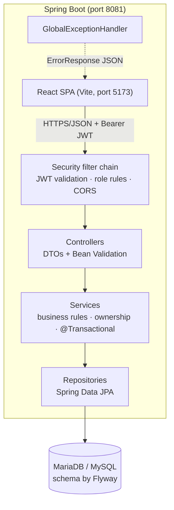
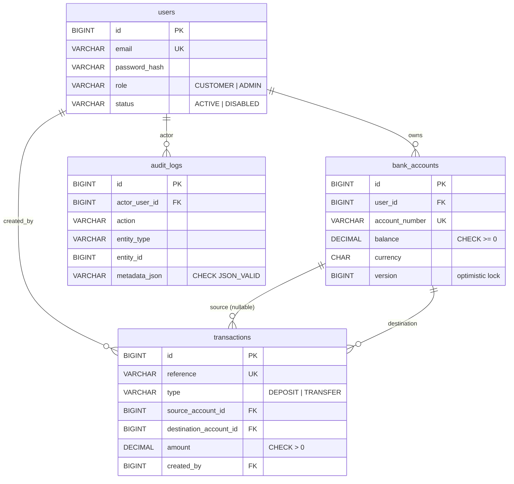

# Banking Transaction Management System

A full-stack **simulated** banking application: customers sign in, view their accounts, browse their
transaction history and transfer money; administrators manage users and inspect an audit log.
The focus is on correct, safe state changes — every transfer is **atomic, concurrency-safe and audited**.

> **Demo project for learning and portfolio use.** It uses fictional data only and is not connected to any
> bank or payment network. Do not use real names, real account details or real money. It has not had the
> professional security review, monitoring and regulatory controls a real banking system requires.

**Stack:** Java 21 · Spring Boot 4.1 · Spring Security (JWT) · Spring Data JPA / Hibernate · Flyway ·
MariaDB / MySQL · React 18 · Vite 5 · JUnit 5 · Mockito · OpenAPI / Swagger UI

---

## Contents

- [Features](#features)
- [Architecture](#architecture)
- [Database design](#database-design)
- [API overview](#api-overview)
- [Getting started](#getting-started)
- [Running the tests](#running-the-tests)
- [Security notes](#security-notes)
- [Known limitations](#known-limitations)
- [Project structure](#project-structure)

---

## Features

**Customers**
- Register and sign in (BCrypt-hashed passwords, JWT access tokens).
- See only their own accounts and balances; other customers' data returns the same `404` as missing data.
- Transfer money to their own accounts or to another customer's account number, with a review step.
- Search transaction history by account, type, status and date range, with sorting and pagination.

**Administrators**
- Search users and enable/disable them — every change is written to the audit log.
- Browse the audit log and all transactions. Administrators cannot move money.

**Engineering highlights**
- **Atomic transfers:** debit, credit, transaction record and audit entry commit together or not at all.
- **Concurrency-safe:** pessimistic row locks taken in a fixed (ascending id) order, so concurrent transfers
  can never overdraw an account or deadlock; `@Version` optimistic locking as a second safety net.
  Integration tests run 20 competing transfers and 80 opposing transfers at once, and were verified to
  **fail when the locking is removed**.
- **Money handled exactly:** `DECIMAL(19,2)` + `BigDecimal` on the server; amounts travel as JSON strings
  (`"250.75"`); over-precise amounts are rejected, never rounded; the frontend never does balance arithmetic.
- **Defence in depth:** Bean Validation, service-level rules, entity guards and database `CHECK` constraints.
- **Consistent errors:** every failure uses one JSON shape with a machine-readable `code`.
- **Versioned schema:** Flyway migrations; Hibernate only validates the schema.

---

## Architecture



| Layer | Responsibility |
|---|---|
| Controller | HTTP mapping, request DTO validation, status codes — no business logic |
| Service | Business rules, ownership checks, transaction boundaries, locking |
| Repository | Database access; ownership built into queries (e.g. `findByIdAndUserId`) |
| Entity | Database-mapped state; never returned directly to the browser |
| DTO | Safe request/response shapes (no password hashes, no internal fields) |

### Transfer algorithm

```text
@Transactional
1. validate amount (> 0, ≤ 2 decimals, ≤ demo limit) and that source ≠ destination
2. check the caller owns the source account (same 404 for "missing" and "not yours")
3. lock both account rows with SELECT … FOR UPDATE, lowest id first
4. re-check: both accounts active, same currency, sufficient balance
5. debit source, credit destination (BigDecimal)
6. insert one TRANSFER transaction (unique reference) + one audit_logs row
7. commit — or roll back everything if any step fails
```

---

## Database design



Migrations live in [`backend/src/main/resources/db/migration`](backend/src/main/resources/db/migration).
A `CHECK` constraint also guarantees that a `DEPOSIT` has only a destination and a `TRANSFER` has two
different accounts. Timestamps are stored in UTC and shown in local time by the browser.

---

## API overview

All endpoints are under `/api/v1`. Interactive documentation: **http://localhost:8081/swagger-ui.html**
(log in, click **Authorize**, paste the `accessToken`).

| Method | Path | Access | Purpose |
|---|---|---|---|
| GET | `/health` | Public | Liveness check |
| POST | `/auth/register` | Public | Create a customer (always role `CUSTOMER`) |
| POST | `/auth/login` | Public | Returns `accessToken` (JWT, 30 min) and profile |
| GET | `/users/me` | Signed in | Current user's profile |
| GET | `/accounts` | Signed in | Caller's own accounts |
| GET | `/accounts/{id}` | Owner / admin | One account |
| GET | `/transactions` | Owner / admin | History; `accountId, from, to, type, status, page, size, sort` |
| GET | `/transactions/{id}` | Owner / admin | One transaction |
| POST | `/transfers` | Customer | Transfer money |
| GET | `/admin/users` | Admin | Paginated users; `q` searches name/email |
| PATCH | `/admin/users/{id}/status` | Admin | Enable/disable a user (audited) |
| GET | `/admin/audit-logs` | Admin | Paginated audit log; `action, entityType` |

**Error format** (every error, every endpoint):

```json
{
  "timestamp": "2026-10-14T09:30:00Z",
  "status": 400,
  "code": "INSUFFICIENT_FUNDS",
  "message": "The source account has insufficient funds.",
  "path": "/api/v1/transfers",
  "fieldErrors": []
}
```

**Example — log in and transfer** (PowerShell):

```powershell
$token = (Invoke-RestMethod -Method Post http://localhost:8081/api/v1/auth/login -ContentType 'application/json' `
  -Body '{"email":"asha@example.com","password":"Demo@12345"}').accessToken

Invoke-RestMethod -Method Post http://localhost:8081/api/v1/transfers -Headers @{ Authorization = "Bearer $token" } `
  -ContentType 'application/json' `
  -Body '{"sourceAccountId":1,"destinationAccountNumber":"100000000003","amount":"25.00","description":"Lunch"}'
```

The same with curl (macOS/Linux):

```bash
TOKEN=$(curl -s -X POST http://localhost:8081/api/v1/auth/login -H 'Content-Type: application/json' \
  -d '{"email":"asha@example.com","password":"Demo@12345"}' | sed -E 's/.*"accessToken":"([^"]+)".*/\1/')

curl -X POST http://localhost:8081/api/v1/transfers -H "Authorization: Bearer $TOKEN" -H 'Content-Type: application/json' \
  -d '{"sourceAccountId":1,"destinationAccountNumber":"100000000003","amount":"25.00","description":"Lunch"}'
```

---

## Getting started

### Prerequisites

| Tool | Version | Check |
|---|---|---|
| JDK | 21 | `java -version` |
| Node.js | 18+ (20+ recommended) | `node --version` |
| MariaDB or MySQL | developed on MariaDB 10.4 (XAMPP) | — |
| Git | any | `git --version` |

Maven is **not** required — the project ships with the Maven Wrapper (`mvnw` / `mvnw.cmd`).

### 1. Clone

```bash
git clone https://github.com/stacwiz-prasanna/banking-transaction-system.git
cd banking-transaction-system
```

### 2. Create the databases and a dedicated user

Run as the database root user (XAMPP: `C:\xampp\mysql\bin\mysql.exe -u root`). Pick your own password.

```sql
CREATE DATABASE banking_mgmt_db      CHARACTER SET utf8mb4 COLLATE utf8mb4_unicode_ci;
CREATE DATABASE banking_mgmt_test_db CHARACTER SET utf8mb4 COLLATE utf8mb4_unicode_ci;
CREATE USER 'banking_app'@'localhost' IDENTIFIED BY 'choose-a-local-password';
GRANT ALL PRIVILEGES ON banking_mgmt_db.*      TO 'banking_app'@'localhost';
GRANT ALL PRIVILEGES ON banking_mgmt_test_db.* TO 'banking_app'@'localhost';
FLUSH PRIVILEGES;
```

You do **not** create any tables — Flyway does that on first start.

### 3. Configure secrets

Copy [`.env.example`](.env.example) to `.env` in the repository root (it is git-ignored) and fill in:

| Variable | Required | Meaning |
|---|---|---|
| `SPRING_DATASOURCE_PASSWORD` | yes | Password of `banking_app` |
| `JWT_SECRET` | yes | Random string, **at least 32 characters** — the app refuses to start otherwise |
| `SPRING_DATASOURCE_URL` | no | Default `jdbc:mariadb://localhost:3306/banking_mgmt_db` |
| `SPRING_DATASOURCE_USERNAME` | no | Default `banking_app` |
| `SERVER_PORT` | no | Default `8081` |
| `CORS_ALLOWED_ORIGINS` | no | Default `http://localhost:5173` |
| `API_DOCS_ENABLED` | no | Default `true`; set `false` to hide Swagger in a deployment |

Generate a JWT secret:

```powershell
# Windows PowerShell
$b = New-Object byte[] 48; [Security.Cryptography.RandomNumberGenerator]::Create().GetBytes($b); [Convert]::ToBase64String($b)
```
```bash
# macOS / Linux
openssl rand -base64 48
```

### 4. Start the backend

```powershell
cd backend
.\mvnw.cmd spring-boot:run        # Windows
./mvnw spring-boot:run            # macOS / Linux
```

Wait for `Started BankingApplication`. On the first start Flyway creates the schema and loads demo data.
Check: http://localhost:8081/api/v1/health → `{"status":"UP",...}`

### 5. Start the frontend

```bash
cd frontend
npm install
npm run dev
```

Open **http://localhost:5173**.

### Demo logins (fictional)

| Email | Role | Password |
|---|---|---|
| `asha@example.com` | Customer — accounts `100000000001`, `100000000002` | `Demo@12345` |
| `ravi@example.com` | Customer — account `100000000003` | `Demo@12345` |
| `admin@example.com` | Admin | `Demo@12345` |

Demo data is loaded only in development (`db/seed`); the test database never receives it.

---

## Running the tests

```powershell
cd backend
.\mvnw.cmd clean test             # Windows
./mvnw clean test                 # macOS / Linux
```

The tests run against the real **`banking_mgmt_test_db`** database (MariaDB must be running), so
constraints, locking and SQL behave exactly as in development.

**Status (15 Oct 2026): 74 tests, 0 failures** on Java 21 / MariaDB 10.4, covering:

| Area | Examples |
|---|---|
| Transfers | success moves the exact amount; zero/negative/3-decimal amounts, insufficient funds, same account, inactive account, currency mismatch, someone else's account — all rejected with balances unchanged |
| Concurrency & rollback | 20 simultaneous transfers never overdraw; 80 opposing transfers never deadlock; a failure injected after the debit and credit rolls everything back |
| Security | missing, expired, edited (`role` changed to ADMIN), attacker-key-signed and wrong-issuer tokens rejected; customers get 403 on admin endpoints; CORS only for the configured origin |
| Ownership | other customers' accounts and transactions return 404 |
| Auth | passwords stored as BCrypt hashes; duplicate email 409; same message for wrong password and unknown email; disabled users locked out even with a valid token |
| Errors | consistent JSON, no stack traces or SQL in responses; lock conflicts return 409 |

Frontend: `cd frontend && npm run build` (no automated frontend tests yet).

---

## Security notes

- **Passwords** are hashed with BCrypt and never returned or logged. Request records override `toString()`
  so a password cannot reach a log line by accident.
- **JWTs** are signed with HS256; signature, expiry and issuer are verified on every request by Spring
  Security's resource-server support (no hand-written token parsing). Tokens contain only the user id and role.
- **Every request re-checks the user in the database**, so disabling a user takes effect immediately.
- **Authorization** is enforced on the server: role rules in the security filter chain plus ownership
  checks in the services. Hidden buttons and guarded routes in React are only a convenience.
- **Stateless API, CSRF disabled:** the token travels in the `Authorization` header, which browsers never
  attach automatically, so cross-site request forgery does not apply. If tokens moved to cookies, CSRF
  protection would have to be re-enabled.
- **Token storage in the browser:** `sessionStorage` (survives a refresh, cleared when the tab closes). Like
  `localStorage`, it is readable by injected script, so the UI never renders untrusted HTML. An httpOnly
  cookie would be safer against XSS at the cost of CSRF handling.
- **Secrets** come from environment variables / a git-ignored `.env`; `.env.example` holds placeholders only.
- **Logs** record business events by id and reference (e.g. `Transfer TRX-… completed`, `Failed login
  attempt`) — never emails, passwords or tokens.

---

## Known limitations

- **No idempotency key yet:** a client that retries a transfer after a network timeout could submit it twice.
  An `Idempotency-Key` header is the planned next step.
- **No refresh tokens or logout revocation:** access tokens last 30 minutes.
- **No rate limiting** on login.
- Rejected transfer attempts are not audited (the audit row rolls back with the failed transaction).
- Developed on **MariaDB 10.4** (XAMPP), which Hibernate 7 reports as below its supported minimum (10.6);
  everything passes, but a newer MariaDB or MySQL 8 is recommended. MySQL 8 has not been tested yet.
- Frontend targets Node 18, so it pins Vite 5 / React Router 6 and has no ESLint setup yet.
- No Docker setup or deployment yet.

---

## Project structure

```text
banking-transaction-system/
├── backend/                      Spring Boot API
│   ├── pom.xml, mvnw, mvnw.cmd
│   └── src/
│       ├── main/java/com/example/banking/
│       │   ├── config/           OpenAPI configuration
│       │   ├── controller/       REST controllers
│       │   ├── dto/              request/response records (auth, account, transaction, transfer, admin, user)
│       │   ├── entity/           JPA entities (User, BankAccount, BankTransaction, AuditLog)
│       │   ├── enums/            Role, statuses, types
│       │   ├── exception/        ApiException, GlobalExceptionHandler
│       │   ├── repository/       Spring Data repositories and query specifications
│       │   ├── security/         SecurityConfig, JWT issuing, @CurrentUserId, JSON 401/403
│       │   └── service/          business logic (TransferService, AuthService, AdminService, …)
│       ├── main/resources/
│       │   ├── application.yml
│       │   └── db/migration/, db/seed/   Flyway schema and dev-only demo data
│       └── test/                 integration, security, concurrency and unit tests
├── frontend/                     React + Vite
│   └── src/
│       ├── api/                  the only code that calls the backend
│       ├── components/           shared UI (tables, pager, alerts)
│       ├── features/             auth, dashboard, accounts, transactions, admin
│       ├── layouts/, pages/, routes/
│       └── utils/                exact money formatting, dates
├── .env.example                  configuration placeholders
└── README.md
```

---

*Built milestone by milestone as a learning project. Fictional data only — not a real bank.*
